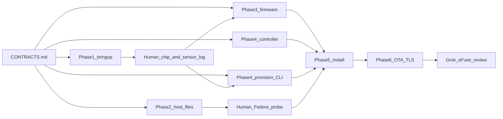

# Phase implementer briefs

Self-contained prompts for fresh agents. Architecture and why-decisions stay in
[../PLAN.md](../PLAN.md). Wire formats and constants are frozen in
[CONTRACTS.md](CONTRACTS.md). **Every coding agent reads CONTRACTS.md first and
does not invent a second protocol.**

## How to launch

1. Open a **fresh** agent chat (no prior phase context).
2. Pick the model from the table below.
3. Paste the entire phase brief file as the user message (or `@`-mention it and say
   "implement this brief").
4. Point the agent at this repo root. Vendored docs: run `./scripts/fetch-docs.sh`
   if `docs/vendor/` is empty.
5. Stop when the brief's exit / stop conditions say so. Do not start the next phase
   in the same chat unless the brief says the work is purely documentary.

Phase 0 and Phase 5 are human checklists. Do not hand them to a coding agent.

## Index

| Brief | Kind | Model | Wave |
| --- | --- | --- | --- |
| [00-ground-rules.md](00-ground-rules.md) | Human checklist | — | Before anything mounts |
| [01-bench-bringup.md](01-bench-bringup.md) | Coding | Composer 2.5 Fast | **A** |
| [02-host-mvp.md](02-host-mvp.md) | Coding + Fedora runbook | Composer 2.5 Fast | **A** |
| [03-firmware-v1.md](03-firmware-v1.md) | Coding | Composer 2.5 Fast | **B** (after chip/sensor log) |
| [04-provision-and-controller.md](04-provision-and-controller.md) | Two coding prompts | Composer 2.5 Fast | Controller in **A**; provision CLI in **B** |
| [05-deploy.md](05-deploy.md) | Human checklist | — | After Phases 2–4 exit on real hardware |
| [06-hardening.md](06-hardening.md) | Coding + Grok eFuse | Composer (OTA/TLS); Grok 4.7 (eFuses) | After Phase 5 week |
| [07-simple-motion-mode.md](07-simple-motion-mode.md) | Coding (prompts A–D) | Composer 2.5 Fast | A + B together, C any time; D after the sync below |
| [07-simple-motion-mode-followup.md](07-simple-motion-mode-followup.md) | Coding (A2, B2) | Composer 2.5 Fast | A2 + B2 together, after 07 A + B; before the sync |
| [SYNC-DEPLOY-PC.md](SYNC-DEPLOY-PC.md) | Git sync, run **on the deployment PC** | Composer 2.5 Fast (Grok 4.7 for firmware conflicts) | After 07 A + B and the follow-up (A2 + B2) are pushed |

[CONTRACTS.md](CONTRACTS.md) is not an agent prompt.

[REVIEW-HANDOFF.md](REVIEW-HANDOFF.md) is a **reviewer** prompt, run after the implementation briefs: it audits what was built and writes `docs/review/FIX-*.md` correction plans, routed to Composer or Grok. It does not change code.

## Models

Use **Composer 2.5 Fast** (`composer-2.5-fast`) for every coding prompt. The
contracts remove the judgement calls.

Use **Grok 4.7** (`grok-4.7-xhigh-fast`) only for the escalations below. Do not
start those prompts until the named evidence exists.

| Escalation | When | What Grok does |
| --- | --- | --- |
| Resolution | After Phase 1 measurements, **only if** HD is not viable (wrong sensor, fps collapse, or thermal throttling) | Update the resolution section in `CONTRACTS.md` and name the `framesize` constant Phase 3 must use. If HD holds, skip. |
| Host probe | After Fedora `lscpu` / `iw list` / `ls /dev/dri`, **only if** no AP mode or CPU older than 6th gen | Pick the plan's named fallback (USB UVC, or CPU detector) and edit the Phase 2 brief / runbook. If the probe matches, Composer’s runbook stands. |
| eFuses | Before anyone runs `espefuse`, after OTA works | Write development-mode-then-release sequence for **one** board and stop for a human. Composer does not burn fuses. |

Phase 5 threshold tuning: if a week of footage does not make the choice obvious,
that is a short Grok pass over the notes, not a new phase brief.

## Parallelism

```text
Wave A (together, as soon as these briefs exist):
  01 bench bring-up project
  02 host repo files + Fedora runbook
  04 controller + pytest   (Prompt A in 04-provision-and-controller.md)

Human gate after Phase 1 flash (do not wait for 24 h soak):
  paste chip-id, 16 MB flash, octal PSRAM, sensor PID from the boot log

Wave B (together, after that paste):
  03 firmware v1
  04 provision CLI         (Prompt B in 04-provision-and-controller.md)

Serial (not parallel):
  05 deploy  ← waits for Phases 2–4 exit checks on real host + boards
  06 OTA/TLS ← after cubicle install has run
  Grok eFuse ← after OTA works; human confirms before espefuse
```



## Suggested paste for Wave A / B

**Wave A agent (example for Phase 1):**

> Implement [docs/phases/01-bench-bringup.md](docs/phases/01-bench-bringup.md).
> Obey [docs/phases/CONTRACTS.md](docs/phases/CONTRACTS.md). Do not start Phase 2–6.

**Wave B agent (example for Phase 3):**

> Implement [docs/phases/03-firmware-v1.md](docs/phases/03-firmware-v1.md).
> Obey [docs/phases/CONTRACTS.md](docs/phases/CONTRACTS.md). Phase 1 boot log says:
> `<paste chip / flash / PSRAM / sensor PID here>`.
